##**<u>Lesson 17: Connecting Shape, Center, and Spread</u>**

###**Objective:**
Students will be able to match histograms, dot plots, and boxplots that tell the same “data story” based on shape. They will identify the shape of a distribution from the features of its boxplot (whisker length and median placement), and determine the most appropriate measures of center (mean or median) and spread (MAD or IQR) based on that shape. They will also create boxplots in CODAP.

###**Materials:**
1. Mingle and Match Plot Triplets ([LMR_U1_L17_A_Mingle_and_Match_Plot_Triplets](../MSDS_Curriculum/2_MSDS_LMRs/MSDS_LMR_Unit_1/LMR_U1_L17_A.pdf))

    ***Advanced preparation required.*** *See Class Setup section for additional details.*

2. Reading Boxplot Shapes ([LMR_U1_L17_B_Reading_Boxplot_Shapes](../MSDS_Curriculum/2_MSDS_LMRs/MSDS_LMR_Unit_1/LMR_U1_L17_B.pdf))

3. Shape, Center, Spread Guide ([LMR_U1_L17_C_Shape_Center_Spread_Guide](../MSDS_Curriculum/2_MSDS_LMRs/MSDS_LMR_Unit_1/LMR_U1_L17_C.pdf))

4. Saved student CODAP files of the Suspect data OR link to the original CODAP Suspect Data File [CODAP Suspect Data File](https://codap.concord.org/app/static/dg/en/cert/index.html#shared=https%3A%2F%2Fcfm-shared.concord.org%2FTtznsLR5Tw98ENyde2PN%2Ffile.json "https://codap.concord.org/app/static/dg/en/cert/index.html#shared=https%3A%2F%2Fcfm-shared.concord.org%2FTtznsLR5Tw98ENyde2PN%2Ffile.json"){:target="_blank"}

5. <b><i>OPTIONAL</b></i>: Chart paper and markers (for the “Clues for Matching Plots” anchor chart

###**Vocabulary:**
n/a

###**Essential Concepts:**

!!! note "Essential Concepts: "
    The shape of a distribution tells us which measures of center and spread are most appropriate. Histograms, dot plots, and boxplots of the same data all tell the same “data story,” so a boxplot’s whiskers and median line reveal shape just like the bars of a histogram. When a distribution is roughly symmetric (no extreme values), the mean and MAD are good choices because they use all data values. When a distribution is skewed or contains extreme values, the median and IQR are better choices because they are not affected by those extremes and are not pulled toward the tail the way the mean and MAD are.

###**Lesson:**

<h3>Class Setup</h3>

- ***Advanced preparation required.***

     - Prior to class, print and cut out the plot cards from the Mingle and Match Plot Triplets document ([LMR_U1_L17_A](../MSDS_Curriculum/2_MSDS_LMRs/MSDS_LMR_Unit_1/LMR_U1_L17_A.pdf)). Cut along the black card borders so that the set headings (e.g., “Symmetric Triplets – Set 1”) are removed.
     
<iframe src="https://docs.google.com/viewerng/viewer?url=https://mscurriculum.thinkdataed.org/MSDS_Curriculum/2_MSDS_LMRs/MSDS_LMR_Unit_1/LMR_U1_L17_A.pdf&embedded=true" style=" width:420px;height:400px;" frameborder="0"></iframe> [LMR_U1_L17_A](../MSDS_Curriculum/2_MSDS_LMRs/MSDS_LMR_Unit_1/LMR_U1_L17_A.pdf)

     - There are 36 cards in total, making 12 Data Triplets: 4 symmetric, 4 skewed right, and 4 skewed left. Each triplet contains 1 histogram (labeled with a letter), 1 dot plot (labeled with a number), and 1 boxplot (labeled with a symbol). Select enough complete triplets so that each student receives one card, using a mix of all three shapes.
     
     - For smaller classes (9 students), use one triplet of each shape, such as Symmetric Set 1, Right-Skewed Set 1, and Left-Skewed Set 1.
     
     - If the number of students is not divisible by 3, give 1 or 2 students an extra card so they belong to 2 triplets, or have a teacher or aide participate.
     
     - Answer key for the Data Triplets. ***Please do not share with students until after the activity.***
     
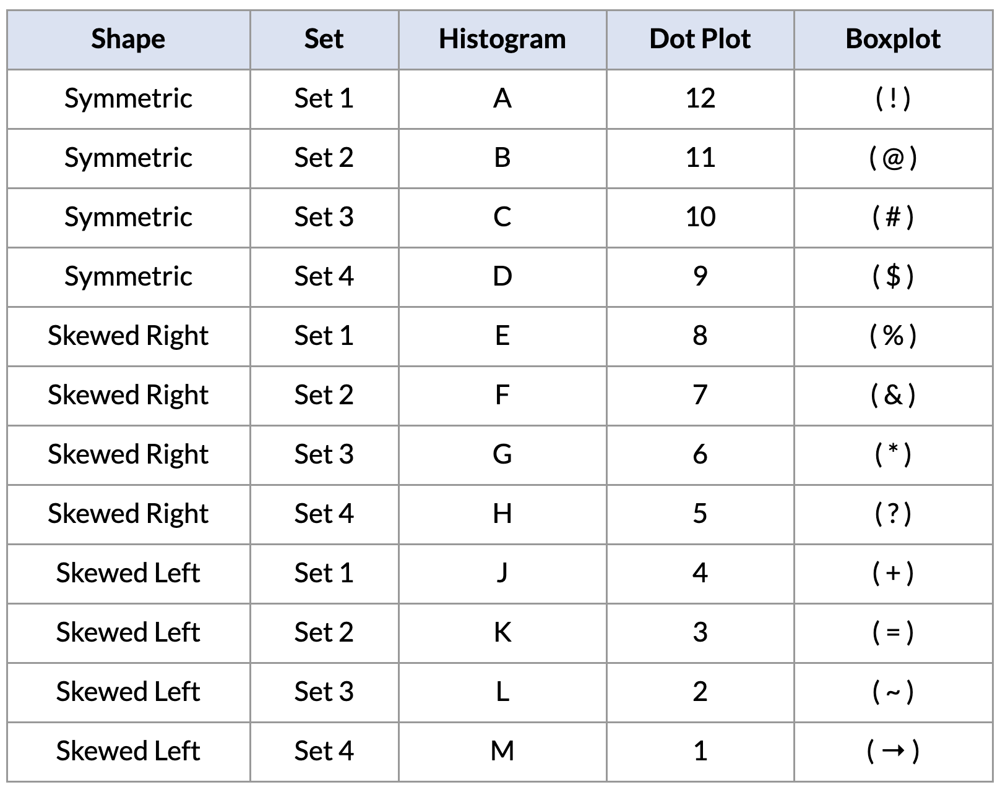

<h3>Opening</h3>

1. Remind students of the tools they have collected so far in their detective toolkit:
    
    100. In [Lesson 12](lesson12.md), they learned to describe the **shape** of a distribution as symmetric, skewed right, or skewed left.
    
    100. In Lessons [13](lesson13.md)–[15](lesson15.md), they learned that the **mean** and **MAD** can be pulled by extreme values, but the median is not affected by them.
    
    100. In [Lesson 16](lesson16.md), they built **boxplots** by hand using the five-number summary and calculated the **IQR**.

2. Introduce today’s activity by discussing the idea of identical and fraternal triplets. Let students explain the difference between identical and fraternal triplets. 

    100. The discussion should focus on the fact that although triplets have the same biological parents and may look similar, fraternal triplets usually have a few different visual characteristics. 
    
    100. We will relate this idea back to the 3 different graphs we use with numerical data: histograms, dot plots, and box plots. Even though the plots look different, they are telling the same “data story” because they come from the same underlying “parent” data. 

3. Explain that today’s mission has two goals: first, find which plots tell the same data story, and second, figure out which measures of center and spread are the right tools for each shape.

    
<h3>Concept Development</h3>

    <b><i>Part 1: Mingle & Match – Find Your Triplets!</b></i>

4. Distribute one plot card from the Mingle and Match Plot Triplets document ([LMR_U1_L17_A](../MSDS_Curriculum/2_MSDS_LMRs/MSDS_LMR_Unit_1/LMR_U1_L17_A.pdf)) to each student detective, but tell them not to show it to anyone yet. They can think of their card as one piece of evidence in today’s case.

5. Explain that the objective is for each student to find the 2 other detectives whose plots tell the exact same data story. Each triplet must have 1 histogram, 1 dot plot, and 1 boxplot that represent the exact same dataset. Encourage students to look at the shape first, and then use the numbers on the x-axis scale to confirm a match.

6. On your signal, tell students to Mingle & Match. They will stand up, walk around the room, and talk with each other while holding their card.

    100. Once three students agree that they have found a matching triplet, they should stand together in one area of the room.
    
    100. Students may not group up silently. They need to use shape vocabulary to explain their plots. For example:
        100. “My dot plot looks skewed to the right. Is your histogram also skewed right?”
        
        100. “My boxplot has a really long whisker on the left, so I think it’s skewed left. Does your dot plot have a long tail on the left?”
        
        100. “My histogram’s tallest bars are in the middle. Does your boxplot have whiskers that are about the same length?”
        
    100. Each triplet needs to agree on the statistical name for their data’s shape (symmetric, skewed right, or skewed left) and be ready to explain why their three plots match.
    
    <table class="ta" style="width:75%;margin:0 auto;">
    <tr>
    <th class="ta-88im" style="width:15%;">
    </th>
    <th class="ta-88nc" style="width:65%;"><b>ADDITIONAL SUPPORT: 
    <i>Sentence Frames for Diverse Learners</i></b>  
    Post the following frames on the board for students to use while they mingle: <ul>
    <li>“My <u>&nbsp;&nbsp;&nbsp;&nbsp;&nbsp;&nbsp;&nbsp;&nbsp;</u> (plot type) looks <u>&nbsp;&nbsp;&nbsp;&nbsp;&nbsp;&nbsp;&nbsp;&nbsp;</u> (shape) because <u>&nbsp;&nbsp;&nbsp;&nbsp;&nbsp;&nbsp;&nbsp;&nbsp;</u>.”</li>
    <li>“Does your <u>&nbsp;&nbsp;&nbsp;&nbsp;&nbsp;&nbsp;&nbsp;&nbsp;</u> (plot type) also have <u>&nbsp;&nbsp;&nbsp;&nbsp;&nbsp;&nbsp;&nbsp;&nbsp;</u>?”</li></ul></th>
    </tr>
    </table>

    <b><i>Part 2: Sharing and Justifying Matches</b></i>

7. Once all triplets have formed, allow one group at a time to present their findings. They can hold up their cards or project them, and explain the visual clues that told them they were a match. ***Sample answer: The dot plot is skewed left, and the histogram is also skewed left because more data are on the right side of the graph and there is a tail on the left side. The boxplot has a longer whisker on the left and the median line in the box is shifted to the right, which also looks skewed left to us.***
    
    <table class="ta" style="width:75%;margin:0 auto;">
    <tr>
    <th class="ta-88im" style="width:15%;">
    </th>
    <th class="ta-88nc" style="width:65%;"><b>ADDITIONAL SUPPORT: 
    <i>Visual Support for Diverse Learners</i></b>  
    Create an Anchor Chart titled “Clues for Matching Plots” and write down the visual clues students mention under a heading for each shape (Symmetric, Skewed Right, Skewed Left).  
    Keep a separate column for boxplot clues. This co-created resource will be used again in Part 3 of this lesson.</th>
    </tr>
    </table>

8. Confirm the correct matches using the answer key in the Class Setup section, and discuss any tricky ones. Ask:

    100. Which plot type was the hardest to match? Why? ***Sample answer: The boxplot, because it does not show the individual data points or the peaks of the data.***
    
    100. What clues did you use to match a boxplot to the other plots? ***Sample answer: Which whisker was longer, where the box sat on the number line, and where the median line was inside the box.***  
    **FUN FACT!** A boxplot summarizes an entire dataset with just five numbers, so we lose some information, like where the peaks are. That is why data detectives need a reliable set of rules for reading shape from a boxplot, which we will build next!

    <b><i>Part 3: Reading Shape from a Boxplot</b></i>

9. Display the boxplot of the Carnival data that students drew in [Lesson 16](lesson16.md), along with its five-number summary.
    
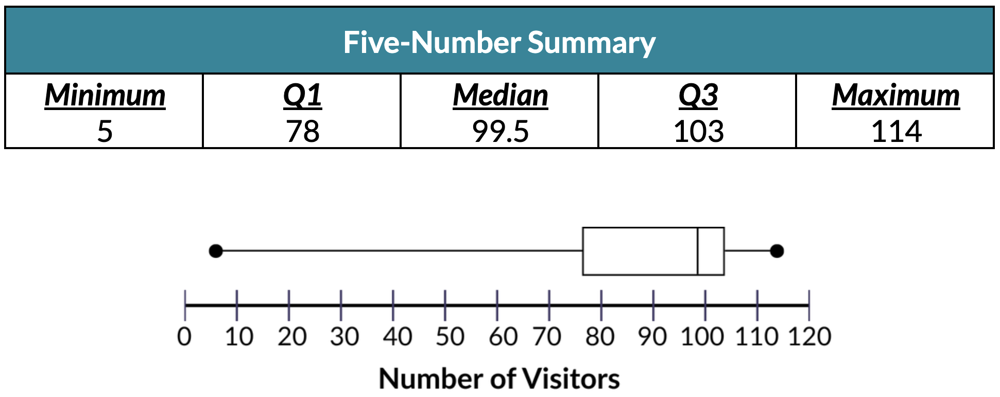

10. Distribute the Reading Boxplot Shapes handout ([LMR_U1_L17_B](../MSDS_Curriculum/2_MSDS_LMRs/MSDS_LMR_Unit_1/LMR_U1_L17_B.pdf)) and have students complete Part 1 with a partner. Then, discuss the answers as a class.
    
<iframe src="https://docs.google.com/viewerng/viewer?url=https://mscurriculum.thinkdataed.org/MSDS_Curriculum/2_MSDS_LMRs/MSDS_LMR_Unit_1/LMR_U1_L17_B.pdf&embedded=true" style=" width:420px;height:400px;" frameborder="0"></iframe> [LMR_U1_L17_B](../MSDS_Curriculum/2_MSDS_LMRs/MSDS_LMR_Unit_1/LMR_U1_L17_B.pdf)

    100. Which side of the boxplot has a longer tail? In other words, which whisker is longer – the left whisker or right whisker? Calculate the following lengths to support your answer. ***Answer: Left whisker length = Q1 – Minimum = 78 – 5 = 73 visitors. Right whisker length = Maximum – Q3 = 114 – 103 = 11 visitors. The longer whisker is on the LEFT SIDE of the boxplot.***
    
    100. What does the length of the longer side/whisker tell us about the ***SHAPE*** of this distribution? Explain your reasoning. ***Sample answer: The distribution is SKEWED LEFT because the data has a long tail on the left side.*** 
    
    100. Where does the median line sit inside the box? Calculate the following lengths to support your answer. ***Answer: Left side of box = Median – Q1 = 99.5 – 78 = 21.5. Right side of box = Q3 – Median = 103 – 99.5 = 3.5. The median is closer to Q3 (right edge).***
    
    100. What does the placement of the median line tell us about the ***SHAPE*** of this distribution? Explain your reasoning. ***Sample answer: The distribution is SKEWED LEFT because the left half of the box is much wider than the right half (the lower values are more spread out).***  
    Connect back to [Lesson 15](lesson15.md): students predicted that the Carnival data would be skewed left because of the Hot Air Balloon. The boxplot now confirms their prediction!

11. Have students complete Part 2 of the handout on their own or in pairs. Answers are provided below:

    100. 
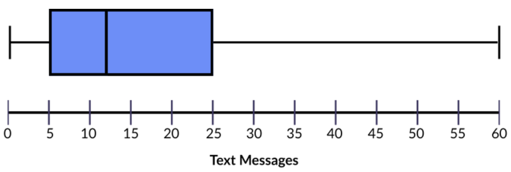

    ***Left whisker length = Q1 – Minimum = 5 - 0 = 5***  
    ***Right whisker length = Maximum – Q3 = 60 - 25 = 35***  
    ***The longer whisker is on the RIGHT SIDE of the boxplot.***  
    ***Left side of box length = Median – Q1 = 12 - 5 = 7***  
    ***Right side of box length = Q3 – Median = 25 - 12 = 13***  
    ***The median is CLOSER to Q1 (left edge).***  
    ***Boxplot Shape: SKEWED RIGHT***  

    100. 
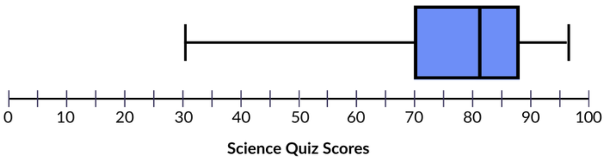

    ***Left whisker length = Q1 – Minimum = 70 - 30 = 40***  
    ***Right whisker length = Maximum – Q3 = 96 - 88 = 8***  
    ***The longer whisker is on the LEFT SIDE of the boxplot.***  
    ***Left side of box length = Median – Q1 = 82 - 70 = 12***  
    ***Right side of box length = Q3 – Median =88 - 82 = 6***  
    ***The median is CLOSER to Q3 (right edge).***  
    ***Boxplot Shape: SKEWED LEFT***  

12. Distribute the Shape, Center, and Spread Guide ([LMR_U1_L17_C](../MSDS_Curriculum/2_MSDS_LMRs/MSDS_LMR_Unit_1/LMR_U1_L17_C.pdf)). Using the Carnival example and the boxplot clues from the anchor chart, guide students to complete Part 1 of the guide. Then, allow students to complete Part 2 on their own.  
    
<iframe src="https://docs.google.com/viewerng/viewer?url=https://mscurriculum.thinkdataed.org/MSDS_Curriculum/2_MSDS_LMRs/MSDS_LMR_Unit_1/LMR_U1_L17_C.pdf&embedded=true" style=" width:420px;height:400px;" frameborder="0"></iframe> [LMR_U1_L17_C](../MSDS_Curriculum/2_MSDS_LMRs/MSDS_LMR_Unit_1/LMR_U1_L17_C.pdf)

13. Answers are provided here:  
    Part 1:
    
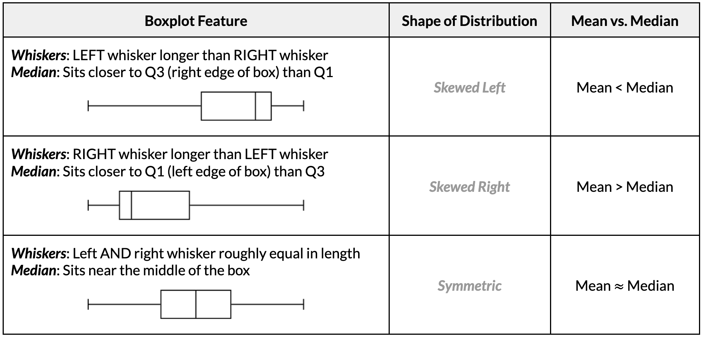

    Part 2: 
    
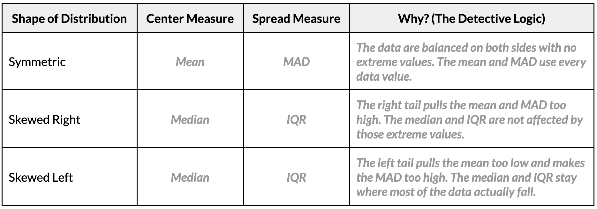

14. **The Golden Guide**: Have students write the following summary in the gold box at the bottom of their guide: ***Symmetric data → use the mean and MAD. Skewed data, or data with extreme values → use the median and IQR, because they are not affected by extreme values.***

15. Have students complete Part 3 of the handout. Answers are provided below.

    100. Carnival Visitors: ***Left skewed, median, IQR***
    
    100. Text Messages: ***Right skewed, median, IQR***
    
    100. Math Quiz Scores: ***Symmetric, mean, MAD***

    <b><i>Part 4: Creating Boxplots in CODAP</b></i>

16. Before students open their computers, demonstrate how to create a boxplot in CODAP with the `LibraryBooks` variable so students can explore the variable.

    100. Open your saved CODAP file of the Suspect data OR use the original [CODAP Suspect Data File](https://codap.concord.org/app/static/dg/en/cert/index.html#shared=https%3A%2F%2Fcfm-shared.concord.org%2FTtznsLR5Tw98ENyde2PN%2Ffile.json "https://codap.concord.org/app/static/dg/en/cert/index.html#shared=https%3A%2F%2Fcfm-shared.concord.org%2FTtznsLR5Tw98ENyde2PN%2Ffile.json"){:target="_blank"}.
    
    100. Click the “Graph” icon, then drag `LibraryBooks` to the x-axis to create a dot plot. Next, click the “Ruler “icon on the right side of the plot and make sure all of the drop-down menu options can be seen.
    
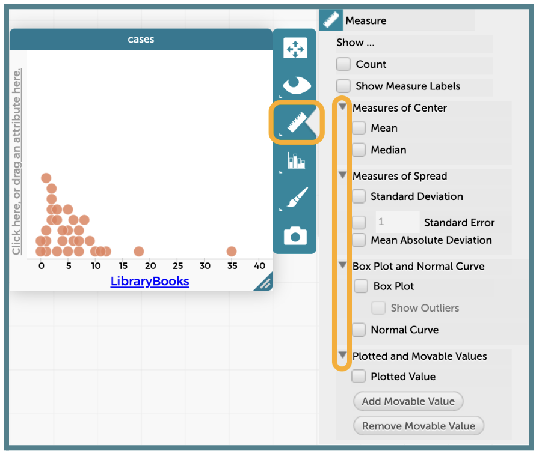

    100. From the “Ruler” menu, check the box for “Box Plot” under “Box Plot and Normal Curve”.
    
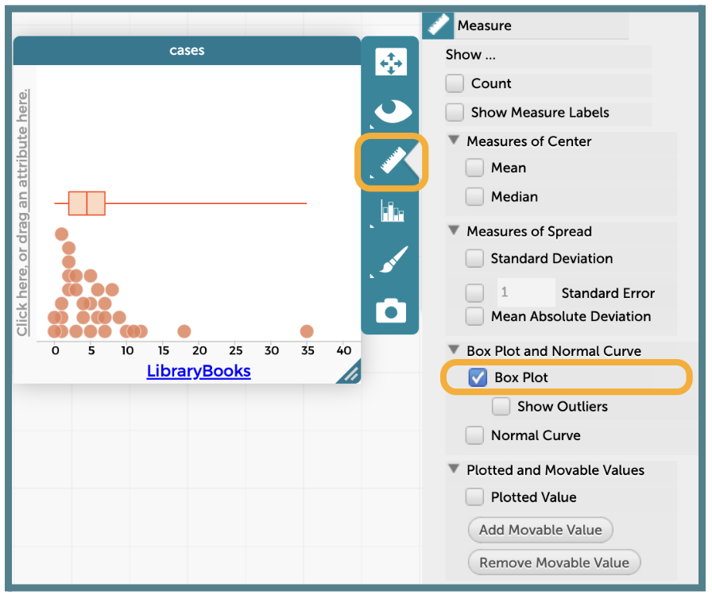

    100. Click the “Ruler” icon and select the boxes for “Show Measure Labels” and “Median” to display the median value on the plot.
    
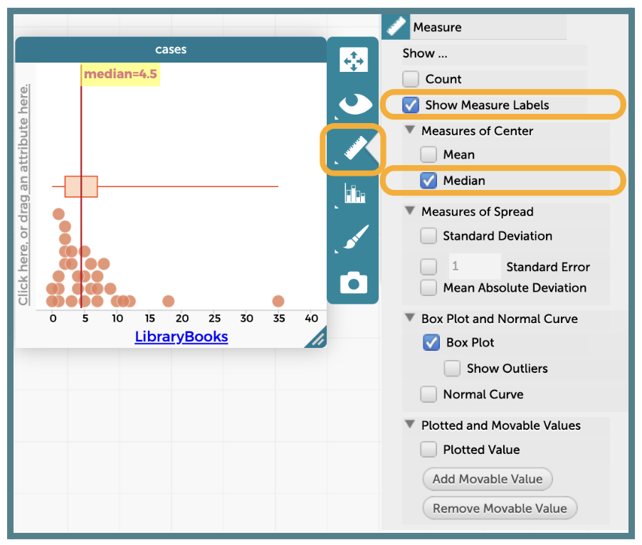

    100. There are 2 ways to display the values for Q1 and Q3 in a boxplot on CODAP. Show both options to students, but encourage them to use the second one so they only need to include one final screenshot in their analysis write-up.

        100. ***Option 1***: The Hover and Hold Method 
            1. Place your cursor on top of the left edge of the box. 

            2. CODAP will display the Q1 value for as long as your cursor stays in that spot. 

            3. Repeat this process on the right edge of the box to display Q3.  
            ***NOTE***: This option does not allow you to see both values at one time.
            
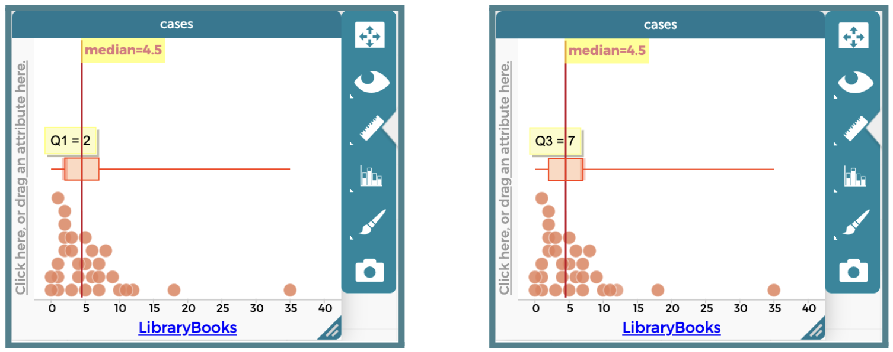

        100. ***Option 2***: The Moveable Value Method
            1. Click the “Ruler” icon and click the button labeled “Add Movable Value.” 

            2. A vertical blue line will be placed within the plot. 

            3. Drag the line so that it sits on the left edge of the box. As long as the “Show Measure Labels” option is selected, the Q1 value will be displayed at the line. 

            4. Click the “Add Movable Value” button again to get a second vertical blue line. 

            5. Drag this line so that it sits on the right edge of the box. As long as the “Show Measure Labels” option is selected, the Q3 value will be displayed at the line.  
            ***NOTE***: If you cannot see the value of your movable line, adjust the placement of the label for the median. Then, add another movable value and drag the line that appears to the other box edge (Q1 for me).
            
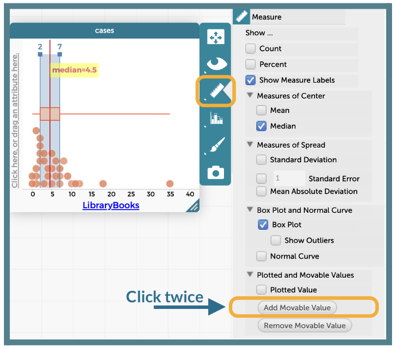

    100. If wanted, you can remove the dots below the boxplot, but it is not necessary. Click the “Paintbrush” icon and adjust the “Point Size” slider all the way to the left. 

17. Use the Shape, Center, and Spread Guide to analyze the `LibraryBooks` boxplot together as a class.
    100. What is the five-number summary? ***Answer: Minimum = 0, Q1 = 2, Median = 4.5, Q3 = 7, Maximum = 35.***

    100. What is the shape of the distribution? How do you know? ***Answer: Skewed right. The right whisker (35 – 7 = 28) is much longer than the left whisker (2 – 0 = 2). The mean (6 books, from Clue #6) is greater than the median (4.5 books).***

    100. Which measures of center and spread are the best tools for this variable? ***Answer: The median (4.5 books) and the IQR (7 – 2 = 5 books), because the data are skewed right with an extreme high value of 35 books.***

18. Instruct students to open their saved CODAP files of the Suspect data OR provide them with the link to the original [CODAP Suspect Data File](https://codap.concord.org/app/static/dg/en/cert/index.html#shared=https%3A%2F%2Fcfm-shared.concord.org%2FTtznsLR5Tw98ENyde2PN%2Ffile.json "https://codap.concord.org/app/static/dg/en/cert/index.html#shared=https%3A%2F%2Fcfm-shared.concord.org%2FTtznsLR5Tw98ENyde2PN%2Ffile.json"){:target="_blank"}. They will create a boxplot for the `GPA` variable on their own and use their guide to choose the best measures.***Answers: Minimum = 2.5, Q1 ≈ 3.4, Median = 3.7, Q3 = 3.9, Maximum = 4.0. The left whisker (≈ 0.9) is much longer than the right whisker (0.1), and the mean (≈ 3.54) is less than the median, so the distribution is skewed left. The median and IQR are the best tools.***

    
    <table class="ta" style="width:75%;margin:0 auto;">
    <tr>
    <th class="ta-88im" style="width:15%;">
    </th>
    <th class="ta-88nc" style="width:65%;"><b>ADDITIONAL SUPPORT: 
    <i>Partner Support for Diverse Learners</i></b>  
    Have students work in pairs. One student can be the “driver” (controlling the mouse) and the other can be the “navigator” (reading the steps). They can switch roles halfway through.</th>
    </tr>
    </table>

    
<h3>Closing</h3>

19. Exit Ticket (if time allows): Display the following five-number summary and boxplot and ask students to answer all three questions before leaving.
    
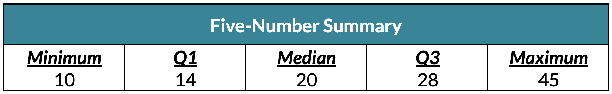

    100. A data point from this distribution has a value of 23. Would it fall in the lower whisker, inside the box, or in the upper whisker? ***Answer: Inside the box, because 23 is between Q1 = 14 and Q3 = 28.***</sapn>
    
    100. The left whisker spans 4 units (from 10 to 14). The right whisker spans 17 units (from 28 to 45). What does this suggest about the shape of the distribution? ***Answer: The distribution is likely skewed right because the longer right whisker shows the data stretch further toward higher values, with a possible extreme high value near 45.***
    
    100. Which measures of center and spread would best describe this distribution? Explain. ***Answer: The median (20) and the IQR (28 – 14 = 14), because the data are skewed right. The mean would be pulled higher by the values in the long right tail.***

20. Key Takeaways: Histograms, dot plots, and boxplots of the same data tell the same story. A boxplot’s whiskers and median line reveal its shape, and the shape tells us which tools to use: mean and MAD for symmetric data, median and IQR for skewed data.

21. Transition: In the next lesson, the data detectives will analyze Clue #8 in CODAP and unmask the Candy Culprit!

