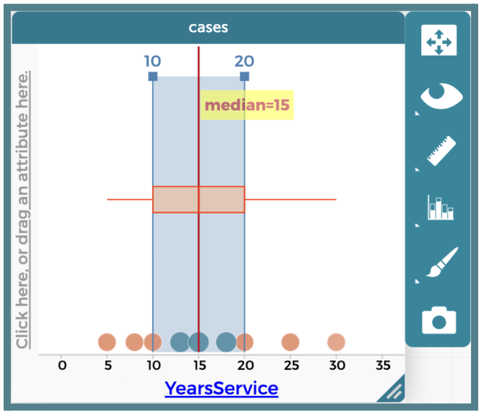
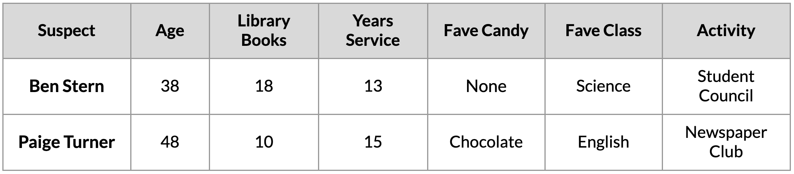

##**<u>Lesson 18: Wrapping Up the Case of the Candy Culprit</u>**

###**Objective:**
Students will apply their boxplot analysis skills in CODAP to evaluate the final clue. They will cross-reference historical case data to eliminate the final suspects, identify the culprit, and document their data cycle findings in an official evidence-based report.

###**Materials:**
1. Candy Culprit Clues [Clue #8] ([LMR_U1_L02_A_Candy_Culprit_Clues](../MSDS_Curriculum/2_MSDS_LMRs/MSDS_LMR_Unit_1/LMR_U1_L02_A.pdf))

2. CODAP Handout for Clue #8 ([LMR_U1_L18_A_Clue8_CODAP_Analysis](../MSDS_Curriculum/2_MSDS_LMRs/MSDS_LMR_Unit_1/LMR_U1_L18_A.pdf))

3. Candy Culprit Suspect Tracker ([LMR_U1_L05_B_Suspect_Tracker](../MSDS_Curriculum/2_MSDS_LMRs/MSDS_LMR_Unit_1/LMR_U1_L05_B.pdf))

4. Saved student CODAP files of the Suspect data OR link to the original [CODAP Suspect Data File](https://codap.concord.org/app/static/dg/en/cert/index.html#shared=https%3A%2F%2Fcfm-shared.concord.org%2FTtznsLR5Tw98ENyde2PN%2Ffile.json "https://codap.concord.org/app/static/dg/en/cert/index.html#shared=https%3A%2F%2Fcfm-shared.concord.org%2FTtznsLR5Tw98ENyde2PN%2Ffile.json"){:target="_blank"}

5. Data Cycle poster [page 5] ([LMR_U1_L01_B_The_Data_Cycle](../MSDS_Curriculum/2_MSDS_LMRs/MSDS_LMR_Unit_1/LMR_U1_L01_B.pdf))

6. DSU FInal Case Report ([LMR_U1_L18_B_DSU_Final_Case_Report](../MSDS_Curriculum/2_MSDS_LMRs/MSDS_LMR_Unit_1/LMR_U1_L18_B.pdf))

###**Vocabulary:**
n/a

###**Essential Concepts:**

!!! note "Essential Concepts: "
    A complete data investigation moves through every phase of the Data Cycle: posing questions, considering data, analyzing data, and interpreting data. Numerical summaries like the quartiles of a boxplot can narrow down possibilities, but sometimes the data alone cannot point to a single answer. Data scientists then weigh all of the available evidence together, including missing values and context, to reach the conclusion that is best supported by the evidence.

###**Lesson:**

<h3>Opening</h3>

1. Urgent announcement: “DSU Squad, an emergency sweep of the faculty lounge just finished. Officers discovered that the staff records have been tampered with! A final note was left on one of the lounge chairs.”

2. Introduce the EIGHTH CLUE of the Candy Culprit investigation. All of the clues can be found in the Candy Culprit Clues document ([LMR_U1_L02_A](../MSDS_Curriculum/2_MSDS_LMRs/MSDS_LMR_Unit_1/LMR_U1_L02_A.pdf)). Have a student volunteer read it aloud.
    
<iframe src="https://docs.google.com/viewerng/viewer?url=https://mscurriculum.thinkdataed.org/MSDS_Curriculum/2_MSDS_LMRs/MSDS_LMR_Unit_1/LMR_U1_L02_A.pdf&embedded=true" style=" width:420px;height:400px;" frameborder="0"></iframe> [LMR_U1_L02_A](../MSDS_Curriculum/2_MSDS_LMRs/MSDS_LMR_Unit_1/LMR_U1_L02_A.pdf)

3. Lead a class discussion about the information that this clue provides. 

    100. First, ask students to recall which suspects are still being considered based on all 7 previous clues. ***Answer: There are only 3 suspects left, and they are ALL staff members – Ben Stern, Paige Turner, and Sage Wright.***

    100. What variable does the clue tell us to analyze? Does it make sense to use this variable based on the remaining suspects? ***Answer: `YearsService`. We can use this because we only have 3 staff members left as possible suspects, and only staff members had values for the `YearsService` variable.***

    100. What kind of graph does the clue describe? How do you know? ***Answer: A boxplot – it mentions the phrase “inside the box,” which is a direct reference to the IQR box.***

    100. What does the phrase “Not Q1 nor 3, but somewhere between” mean? ***Sample answer: The culprit’s `YearsService` value is strictly greater than Q1 AND strictly less than Q3. It falls inside the box, and not on its edges.***

    
<h3>Concept Development</h3>

    <b><i>Part 1: Running the Boxplot Protocol in CODAP</b></i>

4. Instruct students to open their saved CODAP files of the Suspect data OR provide them with the link to the original [CODAP Suspect Data File](https://codap.concord.org/app/static/dg/en/cert/index.html#shared=https%3A%2F%2Fcfm-shared.concord.org%2FTtznsLR5Tw98ENyde2PN%2Ffile.json "https://codap.concord.org/app/static/dg/en/cert/index.html#shared=https%3A%2F%2Fcfm-shared.concord.org%2FTtznsLR5Tw98ENyde2PN%2Ffile.json"){:target="_blank"}. 

5. Distribute the Clue #8 CODAP Analysis handout ([LMR_U1_L18_A](../MSDS_Curriculum/2_MSDS_LMRs/MSDS_LMR_Unit_1/LMR_U1_L18_A.pdf)), and instruct students to complete Steps 1 through 4 to determine which suspects they can eliminate from our list.
    
<iframe src="https://docs.google.com/viewerng/viewer?url=https://mscurriculum.thinkdataed.org/MSDS_Curriculum/2_MSDS_LMRs/MSDS_LMR_Unit_1/LMR_U1_L18_A.pdf&embedded=true" style=" width:420px;height:400px;" frameborder="0"></iframe> [LMR_U1_L18_A](../MSDS_Curriculum/2_MSDS_LMRs/MSDS_LMR_Unit_1/LMR_U1_L18_A.pdf)

    
    <table class="ta" style="width:75%;margin:0 auto;">
    <tr>
    <th class="ta-88im" style="width:15%;">
    </th>
    <th class="ta-88nc" style="width:65%;"><b>ADDITIONAL SUPPORT: 
    <i>Partner Support for Diverse Learners</i></b>  
    Have students work in pairs. One student can be the “driver” (controlling the mouse) and the other can be the “navigator” (reading the steps). They can switch roles halfway through.</th>
    </tr>
    </table>

6. Circulate around the room to provide guidance and support as students work in CODAP. 

7. Once all students have completed their analysis, engage in a whole class discussion about the results. Below is a sample CODAP boxplot that students might create.
    

    100. Which variable did you analyze for this clue? ***Answer: `YearsService`.***

    100. Which numerical summaries did you calculate or find, and what were their values? ***Answer: Median, Q1, Q3, and the IQR. Median = 15, Q1 = 10, Q3 = 20, IQR = 20 - 10 = 10.*** 

    100. The Candy Culprit tells us that their value for `YearsService` is “Not Q1 nor 3, but somewhere between.” Which values satisfy the statement, and what does this mean about who remains a suspect? ***Answer: We need to calculate Mean + MAD, which comes out to 22.33 + 13.8 = 36.13.*** 

    100. How many suspects satisfy the clue’s condition? Who are they? ***Answer: There are 3 suspects who satisfy the condition – Ben Stone (13 years of service), Paige Turner (15 years of service), Myles Stone (18 years of service).***

    100. Out of the suspects you identified in part (d), how many NEW suspects can you eliminate after this clue? Who are they? ***Answer: There is only 1 new suspect to eliminate – Sage Wright (the English Teacher). She has 10 years of service at the school, which places her exactly at the Q1 edge of the box.***

    100. How many people remain as potential Candy Culprit suspects? Who are they? Is this what you expected? ***Sample answer: There are still 2 remaining suspects – Ben Stern (the Nurse), and Paige Turner (the Librarian). I expected to only have 1 suspect left since this is the last clue, so I might need to recheck my analyses to see if I made any mistakes. It is also possible that there simply are 2 possible suspects, and I need to make an inference, or guess, about which person makes the MOST sense.*** 

8. Have students take out their Candy Culprit Suspect Tracker ([LMR_U1_L05_B](../MSDS_Curriculum/2_MSDS_LMRs/MSDS_LMR_Unit_1/LMR_U1_L05_B.pdf)) sheet so they can cross off the newly eliminated suspects. An example of the updated suspect tracker is provided below. 
    

    <b><i>Part 2: The Suspect Showdown</b></i>

9. Explain that every clue has now been tested, and two suspects are still standing. **Share that real data scientists face this situation often: data can narrow down the possibilities, but it cannot always point to one single answer.** When that happens, detectives must weigh ALL of the evidence together.

10. Have students complete Part 5 of the Clue #8 CODAP Analysis handout ([LMR_U1_L18_A](../MSDS_Curriculum/2_MSDS_LMRs/MSDS_LMR_Unit_1/LMR_U1_L18_A.pdf)) by looking up each suspect’s values in their CODAP case table. The completed data comparison is below.
    

11. Lead a discussion comparing the two suspects clue by clue.

    100. Clues #1 and #2 both described chocolate being stolen. What does the data tell us about each suspect? ***Answer: Paige Turner’s favorite candy is chocolate. Ben Stern’s FaveCandy value is missing, so the data cannot connect him to the stolen chocolate, and it cannot rule him out either.***

    100. Clues #5 and #6 said the culprit reads a lot, “above that share” of 6 books. Does this clue separate the two suspects? ***Answer: No. Both are above the mean of 6 books (Ben has 18 and Paige has 10), so this clue does not help us choose between them.***

    100. Clue #7 said the culprit is “just slightly older” than the mean age plus one MAD (36.13 years). Which suspect fits this best? ***Sample answer: Ben Stern (38) is closer to 36.13 than Paige Turner (48), so this clue leans slightly toward Ben. Evidence does not always point in the same direction!***

    100. Clue #8 placed the culprit “inside the box.” Where does each suspect fall? ***Answer: Both are inside the box. Paige Turner’s 15 years sits exactly on the median line, right in the middle of the box.***

    100. Weighing all the evidence, who is the Candy Culprit? Which piece of evidence is the strongest? 

        100. ***Sample answer – BEN STERN: I chose Ben Stern as the Candy Culprit. Ben doesn’t have a favorite candy because, as a nurse, he thinks candy is bad for you. But none of the clues say the culprit’s favorite candy is chocolate. Clues #1 and #2 only say chocolate was taken. In Clues #3 and #6, the culprit took every piece of candy they could find, not just chocolate. So taking candy doesn’t mean the culprit loves candy. Maybe a nurse who thinks candy is unhealthy is taking it away from students! Also, Clue #7 said the culprit is “just slightly older” than 36.13 years, and Ben is 38 while Paige is 48. Ben checked out more library books than Paige (18 vs. 10). He is also in Student Council, and Clue #6 happened right after a Student Council meeting.***

        100. ***Sample answer – PAIGE TURNER: I chose Paige Turner as the Candy Culprit. Every crime involved candy being stolen, and in Clues #1 and #2 it was chocolate, which is Paige’s favorite candy. Ben doesn’t have a favorite candy because, as a nurse, he thinks candy is bad for you, so he doesn’t have a reason to steal it. Clues #5 and #6 said the culprit reads a lot, above the mean of 6 books. Paige checked out 10 books, so she fits. Even though Ben checked out more, both are above the mean, so this clue doesn’t rule her out. Clue #6 also says the culprit loves finding lost books and organized the library books into piles, which sounds like a librarian. For Clue #7, Paige is 48, which is older than 36.13. The clue also says the culprit is a retro gamer who “lives in the past,” and Paige is old enough to remember 1980s arcade games. Finally, for Clue #8, Paige’s 15 years of service sits exactly on the median line, right in the middle of the box.***

    <b><i>Part 3: Connecting the Case to the Data Cycle</b></i>

12. Display the Data Cycle poster ([LMR_U1_L01_B](../MSDS_Curriculum/2_MSDS_LMRs/MSDS_LMR_Unit_1/LMR_U1_L01_B.pdf)). Ask students to think back over the entire investigation and identify what they did in each phase. Record their answers on the board. 
    
<iframe src="https://docs.google.com/viewerng/viewer?url=https://mscurriculum.thinkdataed.org/MSDS_Curriculum/2_MSDS_LMRs/MSDS_LMR_Unit_1/LMR_U1_L01_B.pdf&embedded=true" style=" width:420px;height:400px;" frameborder="0"></iframe> [LMR_U1_L01_B](../MSDS_Curriculum/2_MSDS_LMRs/MSDS_LMR_Unit_1/LMR_U1_L01_B.pdf)

13. Sample answers:

    100. Pose Questions: Who is the Candy Culprit? We also asked statistical questions for each clue, such as “How many library books do suspects typically check out?”

    100. Consider Data: We built suspect dossiers, organized evidence into a data table, identified numerical and categorical variables, and handled missing values.

    100. Analyze Data: We created bar graphs, dot plots, histograms, and boxplots, and calculated the mean, MAD, median, quartiles, and IQR.

    100. Interpret Data: We used our results to eliminate suspects after each clue and weighed all of the evidence to identify the culprit.

14. Emphasize that the Data Cycle is not a straight line. Each new clue sent the detectives back to pose a new question, consider a new variable, and analyze again.

    <b><i>Part 4: Compiling the Final Case Report</b></i>

15. Distribute the DSU Final Case Report ([LMR_U1_L18_B](../MSDS_Curriculum/2_MSDS_LMRs/MSDS_LMR_Unit_1/LMR_U1_L18_B.pdf)). Explain that to close a case, senior data detectives do not just point fingers; they write an ironclad report that shows the evidence for their conclusion.
    
<iframe src="https://docs.google.com/viewerng/viewer?url=https://mscurriculum.thinkdataed.org/MSDS_Curriculum/2_MSDS_LMRs/MSDS_LMR_Unit_1/LMR_U1_L18_B.pdf&embedded=true" style=" width:420px;height:400px;" frameborder="0"></iframe> [LMR_U1_L18_B](../MSDS_Curriculum/2_MSDS_LMRs/MSDS_LMR_Unit_1/LMR_U1_L18_B.pdf)

16. Students work individually to complete their official reports, including:

    100. The identity and role of the culprit.

    100. Evidence Brief A (The Center): How the mean and MAD of Age narrowed the suspects to staff members.

    100. Evidence Brief B (The Boxplot): The five-number summary of YearsService and why Sage Wright was eliminated.

    100. Evidence Brief C (The Showdown): The data comparison of Ben Stern and Paige Turner and a justification of the final verdict.

    100. Evidence Brief D (Choosing the Right Tools): Why the median and IQR are better tools than the mean and MAD for skewed data.

    100. The Data Cycle Summary: One example of their work from each phase of the Data Cycle.

    
<h3>Closing</h3>

17. Collect the Final Case Reports as a summative assessment for the unit.

18. Transition: Congratulate the rookies on solving the Case of the Candy Culprit! Explain that they will show off their detective skills in Progress Check 3 before beginning their next assignment in Unit 2.
