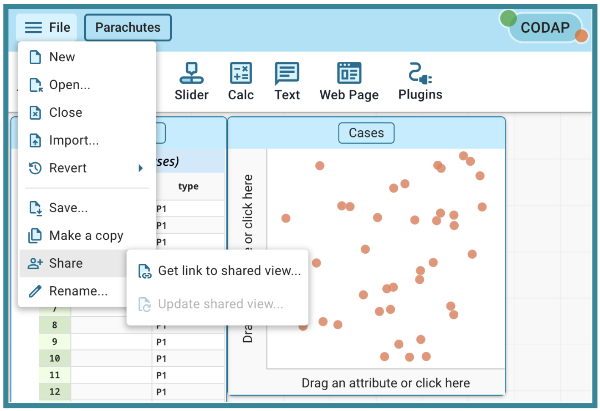
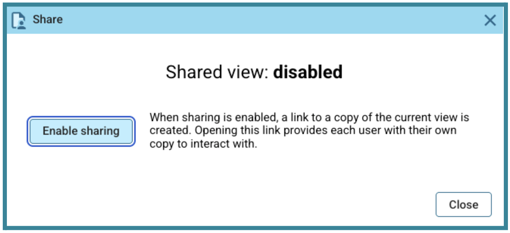
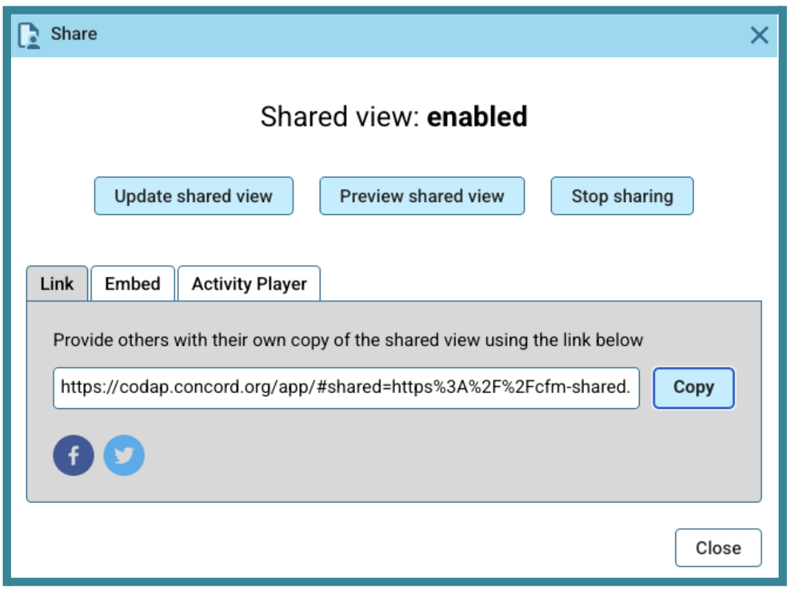

##**<u>Lesson 1: Compair-a-Chutes</u>**

###**Objective:**
Students will collect precise descent time data for two similarly constructed parachutes and see that there is inherent variability within data for each parachute and also between the two parachutes.

###**Materials:**

1. Materials for parachute construction – enough for two parachutes:
    100. Tissue paper or plastic bags
    
    100. Scissors

    100. Ruler

    100. Tape

    100. 1-hole punch

    100. String, yarn, twine or fishing line

    100. Weighted item of approximately 4.5-5.5 grams (examples: small non-breakable action figure, Lego mini-figure, 25 mm binder clip or metal washers)

    100. Location from which to drop a parachute from the same height

2. How to Make a Parachute handout ([LMR_U2_L01_A_How_to_Make_a_Parachute](../MSDS_Curriculum/2_MSDS_LMRs/MSDS_LMR_Unit_2/LMR_U2_L01_A.pdf)) – instructions to create Parachute P1 (prior to class) and Parachute P2 (as a demo during class)
    ***Advanced preparation required.*** *See Class Setup section for additional details.*

3. [How to Make a Parachute](https://www.sciencebuddies.org/stem-activities/parachutes?ytid=6RA9x4wlnW8&ytsrc=description "https://www.sciencebuddies.org/stem-activities/parachutes?ytid=6RA9x4wlnW8&ytsrc=description"){:target="_blank"} video clip [see usage permission in [References](../references.md)]

4. Sample Parachute P1 (pre-made by teacher at least a day in advance)
    ***Advanced preparation required.*** *See Class Setup section for additional details.*

5. Sample Parachute P2 (as a demo during class)

6. Compair-a-Chutes Descent Times handout ([LMR_U2_L01_B_Compair-a-Chutes_Descent_Times](../MSDS_Curriculum/2_MSDS_LMRs/MSDS_LMR_Unit_2/LMR_U2_L01_B.pdf)) – one copy for demo group

7. Stopwatch

8. Tape measure

9. Link to [CODAP Parachutes Data File](https://codap.concord.org/app/#shared=https%3A%2F%2Fcfm-shared.concord.org%2FnkbkaRprTXBiYVdhMLp9%2Ffile.json "https://codap.concord.org/app/#shared=https%3A%2F%2Fcfm-shared.concord.org%2FnkbkaRprTXBiYVdhMLp9%2Ffile.json"){:target="_blank"}

###**Vocabulary:**

n/a

###**Essential Concepts:**

!!! note "Essential Concepts: "
    Accurate data collection is important to ensure that differences between distributions are due to the independent variable rather than uncontrolled factors. Variability exists within a dataset and between datasets of data collected in similar ways.

###**Lesson:**

<h3>Class Setup</h3>

- ***Advanced preparation required.***

    - At least one day prior to class, collect and cut materials to construct 2 parachutes with square canopies that measure 144 in2 (12 in. x 12 in.).

        - Watch the [video](https://www.sciencebuddies.org/stem-activities/parachutes?ytid=6RA9x4wlnW8&ytsrc=description "https://www.sciencebuddies.org/stem-activities/parachutes?ytid=6RA9x4wlnW8&ytsrc=description"){:target="_blank"} on how to construct a parachute.

        - Using one set of the materials and the How to Make a Parachute instructions ([LMR_U2_L01_A](../MSDS_Curriculum/2_MSDS_LMRs/MSDS_LMR_Unit_2/LMR_U2_L01_A.pdf)), construct a parachute. This parachute will be referred to as Parachute P1.
        
<iframe src="https://docs.google.com/viewerng/viewer?url=https://mscurriculum.thinkdataed.org/MSDS_Curriculum/2_MSDS_LMRs/MSDS_LMR_Unit_1/LMR_U1_L02_A.pdf&embedded=true" style=" width:420px;height:400px;" frameborder="0"></iframe> [LMR_U2_L01_A](../MSDS_Curriculum/2_MSDS_LMRs/MSDS_LMR_Unit_1/LMR_U2_L01_A.pdf)

        - Data from Parachute P1 is collected by the teacher in advance of class and stored in the CODAP Parachutes Data File. The time variable is a numeric variable set to 2 decimal places. The type variable is a categorical variable with values of P1 or P2, identifying which of the two parachutes the time corresponds to.

        - Store the second set of materials for use during the lesson. These will be used as a demo during class on how to construct a parachute - this will be Parachute P2.

    - Using Parachute P1, run 20 parachute drop trials from the same height and with the same process that your students will use when they collect data.

        - Record the times to the nearest hundredth of a second for each of the 20 trials in the [CODAP Parachutes Data File](https://codap.concord.org/app/#shared=https%3A%2F%2Fcfm-shared.concord.org%2FnkbkaRprTXBiYVdhMLp9%2Ffile.json "https://codap.concord.org/app/#shared=https%3A%2F%2Fcfm-shared.concord.org%2FnkbkaRprTXBiYVdhMLp9%2Ffile.json"){:target="_blank"}. Add the descent times to rows 1-20 in the time column.  
        ***NOTE***: It is important to collect your data in the exact same manner that students will collect their data to prevent confounding variables from affecting the results and leading to misleading associations. This includes:
            
          - Using the same weight and same type of payload (see Materials 1g for suggestions).
          
          - Having a consistent drop height. This will vary depending on what options are available in the classroom and school. Suggestions for drop locations include balconies, stairwells (if open enough), a stage, or stadium bleachers. To avoid wind from affecting descent times it is suggested to complete the data collection indoors.
          
          - Applying a consistent drop mechanism. Suggestions include finger grip (how you hold the parachute), clothespins, chip clips, or binder clips.

    - Once all 20 descent times have been recorded on the Parachutes Data File, rename the file to “P1 vs P2 Descent Times” and save it for use during the lesson.

    - After collecting the 20 descent times for Parachute P2 during the lesson, create a shareable link for the completed Parachutes Data File. Detailed instructions for creating the link are below:

        - From the navigation menu icon (hamburger menu) choose **Share** and **Get link to shared view**.
        

        - Choose Enable sharing.
        

        - Select **Copy** in the Share window when it appears. Save the copied link to share with students in [Lesson 3](lesson3.md).
        

<h3>Opening</h3>

1. Show students the standard large square parachute with the payload attached. Refer to this parachute as Parachute P1.

2. Describe and demonstrate for students the process you used in the second main bullet of Class Setup (after *Advanced preparation required*) above to collect the descent time data for Parachute P1.

3. Project the CODAP document you prepared in advance in the third main bullet of Class Setup (after *Advanced preparation required* above) and explain that these are the times for the 20 parachute landings you collected using Parachute P1.

4. Ask students to look at the data and what they notice and what they wonder about the data. After students have had 2 minutes to study the data, allow several students to share what they notice or wonder and write these observations on the board.

5. Add a graph to the CODAP workspace and drag the **time** variable to the x-axis to make a dotplot. Adjust the x-axis as needed to display all points clearly. Hold up the parachute again and ask students “If I were to drop this parachute again from the same height I did before, how many seconds would it take to land and why do you think that?” The goal is to get students to suggest estimating the median or mean for the time and to make an observation about the spread of the data. Use the following questions to prompt students as needed:
    100. “If we had to pick one number to represent the **typical** descent time for this design, what would it be?”

    100. “How reliable is this parachute? Does it do the same thing every time, or is there a lot of spread?”

    
<h3>Concept Development</h3>

    <b><i>Part 1: Construct Parachute P2</b></i>

6. Following the instructions on the How to Make a Parachute handout ([LMR_U2_L01_A](../MSDS_Curriculum/2_MSDS_LMRs/MSDS_LMR_Unit_2/LMR_U2_L01_A.pdf)) and using the materials you prepared to construct Parachute P2, demonstrate for students how to construct the standard square parachute. Show them how to cut the materials to size, assemble the parachute and attach the payload.   ***NOTE***: The goal is to show that even if there is not a modification to the parachute, with two parachutes that are designed the same there will be inherent variability in the data between them but hopefully not a significant amount. <i><u>Do not reveal this at this time</i></u>. Allow this to be revealed during the closing.

    <b><i>Part 2: Building the Definition of Data</b></i>

7. As a class, define the “Rules of the Drop” in order to standardize the data collection. Things to consider include:

    100. When does the timer start – *typically when the parachute is released.*

    100. When does the timer end – *typically when the payload touches the ground.*

    100. From what height is the parachute dropped – *varies depending on what options are available. Suggestions for drop locations include from balconies, in stairwells if open enough, from the top of playground equipment like a slide, from a stage, or from gymnasium or stadium bleachers.*

    100. Mechanism for the drop – *suggestions include finger grip, clothespins, chip clips or binder clips.*

8. Demonstrate how to complete the descent time data collection by asking students to collect the data. Choose four students for the following roles and guide them to collect 20 descent times for Parachute P2. Give a copy of the Compair-a-chutes Descent Times handout ([LMR_U2_L01_B](../MSDS_Curriculum/2_MSDS_LMRs/MSDS_LMR_Unit_2/LMR_U2_L01_B.pdf)) to the student that will be the Data Clerk. To maintain consistency, have the same four students complete all the data collection for these drops. 
    
<iframe src="https://docs.google.com/viewerng/viewer?url=https://mscurriculum.thinkdataed.org/MSDS_Curriculum/2_MSDS_LMRs/MSDS_LMR_Unit_1/LMR_U1_L02_A.pdf&embedded=true" style=" width:420px;height:400px;" frameborder="0"></iframe> [LMR_U2_L01_A](../MSDS_Curriculum/2_MSDS_LMRs/MSDS_LMR_Unit_1/LMR_U2_L01_A.pdf)

    
    <table class="tg" style="width:85%;margin:0 auto;">
    <tr>
    <th class="tg-88im" style="width:15%;"></th>
    <th class="tg-88nc" style="width:65%;"><b>GROUP ROLES: <i>The Pilot</i></b>  <ul>
    <li>This student ensures a clean release and announces when they are releasing the parachute. They maintain the required standards for each drop.</li></ul>
    <b><i>The Data Clerk</i></b>  <ul>
    <li>This student manages the data collection recording sheet ensuring that each successful drop is numbered and recorded clearly and to the nearest hundredth of a second.</li></ul>
    <b><i>The Timer</i></b> <ul>
    <li>This student operates the stopwatch and maintains focus on the payload; they start the timer when the Pilot says “go” and stop the timer when the payload touches ground. They report the time of the descent, rounded to the nearest hundredth of a second, to the Data Clerk.</li></ul>
    <b><i>The Quality Inspector</i></b> <ul>
    <li>This student watches each flight path to ensure it does not hit a wall, get caught in a draft or tangled. They call “No-Drop” if the conditions of the drop did not follow the required standards as agreed upon in Step 7 above.</li></ul></th>
    </tr>
    </table> 

9. Instruct the remaining students to observe the data collection process.  After the first trial, stop and lead a brief whole class discussion on how well the “Rules of the Drop” were followed. Ask students for suggestions on how the drop process might be improved. Agree as a class if this first drop will be considered a success or if it needs to be scraped and repeated. As the four students continue to collect the data; stop every few trials and have students provide additional feedback.

10. After the descent times of 20 successful drops are recorded on the handout, return to the CODAP file that you demonstrated in Steps 3 through 5 above and add the 20 descent times for Parachute P2 in rows 21-40.

11. Create stacked dot plots by dragging the variable “type” to the y axis. 

12. Lead a class discussion about how the descent times compare using the following guiding questions:

    100. Are the descent times for Parachute P1 and Parachute P2 the same?

    100. What is a typical descent time for Parachute P2 and how does that compare to the typical descent time of Parachute P1 (from Step 3 above)?

    100. Compare the consistency in the descent times of Parachute P1 and Parachute P2. Which parachute has more consistent descent times?

13. Explain that even though the two parachutes were constructed using the same materials and dimensions, we would not expect to get the same 20 descent times, or the same center and spread. We would expect to see variability both within each dataset and between the two datasets.

    
<h3>Closing</h3>

14. Determine the average descent time of all 40 drops but do not tell the class what it is. 

15. Exit Ticket: Ask a few students to  share their responses to the following prompt:

    100. “If I told you that I dropped one of these two parachutes and the descent time was ______ (fill in the blank with the average from Step 14 above), could you tell me with certainty whether I dropped  Parachute P1 or Parachute P2? Explain.” (see Key Takeaway below)

16. Key Takeaway: Explain that even though there is variability within and between Parachute P1 and Parachute P2, since the two parachutes were constructed using the same materials and dimensions, we would expect the data collected for both of them to be similar enough that we would probably not be able to identify which parachute the given descent time came from.

