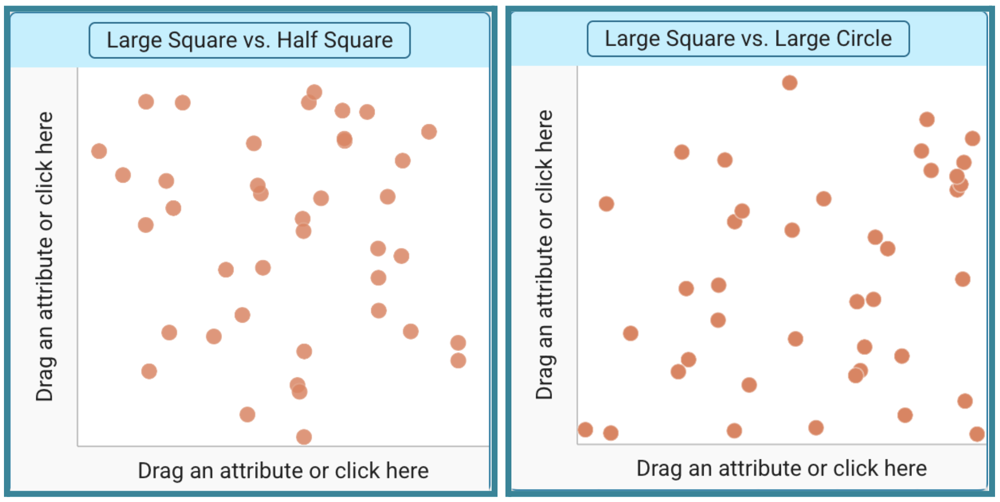
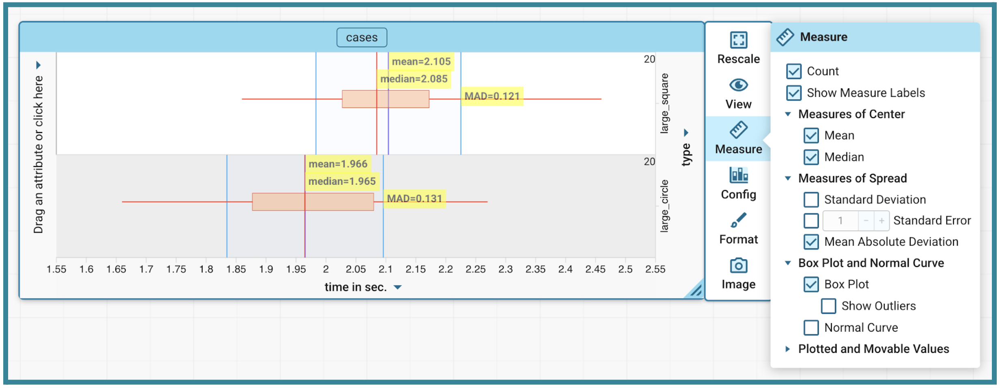
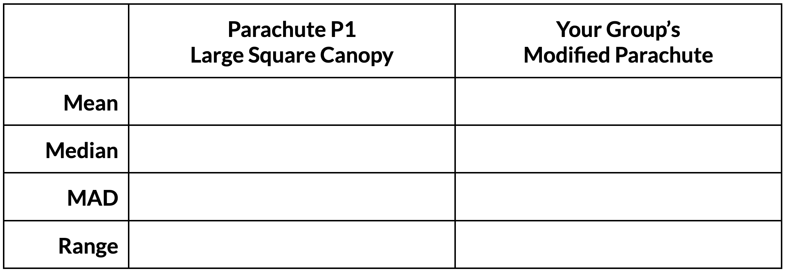

##**<u>Lesson 3: Compare-a-Chutes</u>**

###**Objective:**
Students will use CODAP to construct stacked box plots and informally assess if a difference is meaningful.

###**Materials:**

1. Data collected during [Lesson 2](lesson2.md)

2. Computers or devices with ability to access CODAP

3. [CODAP Parachutes Data File](https://codap.concord.org/app/#shared=https%3A%2F%2Fcfm-shared.concord.org%2FnkbkaRprTXBiYVdhMLp9%2Ffile.json "https://codap.concord.org/app/#shared=https%3A%2F%2Fcfm-shared.concord.org%2FnkbkaRprTXBiYVdhMLp9%2Ffile.json"){:target="_blank"} (created during [Lesson 1](lesson1.md) to share with students)  
***NOTE***: This will open an independent copy of the file for each student to save to their local computer or Google Drive.

4. Compare-a-Chutes handout ([LMR_U2_L03_A_Compare-a-Chutes](../MSDS_Curriculum/2_MSDS_LMRs/MSDS_LMR_Unit_2/LMR_U2_L03_A.pdf)) – one per group

###**Vocabulary:**
[stacked box plot](../../vocabulary/unit1/#stacked-box-plot "a data visualization where box plots are aligned vertically on a shared axis"){ .md-button }

###**Essential Concepts:**

!!! note "Essential Concepts: "
    Stacked box plots allow for a direct comparison of **typical values** and **variability**, helping us decide if a difference is meaningful.

###**Lesson:**

<h3>Opening</h3>

1. Distribute a copy of the Compare-a-Chutes handout ([LMR_U2_L03_A](../MSDS_Curriculum/2_MSDS_LMRs/MSDS_LMR_Unit_2/LMR_U2_L03_A.pdf)) to each group. Explain that students will work in their groups to complete the tasks and answer the questions outlined throughout the lesson.   ***NOTE***: The lesson below directly guides students through the Compare-a-Chutes handout.
    
<iframe src="https://docs.google.com/viewerng/viewer?url=https://mscurriculum.thinkdataed.org/MSDS_Curriculum/2_MSDS_LMRs/MSDS_LMR_Unit_2/LMR_U2_L03_A.pdf&embedded=true" style=" width:420px;height:400px;" frameborder="0"></iframe> [LMR_U2_L03_A](../MSDS_Curriculum/2_MSDS_LMRs/MSDS_LMR_Unit_2/LMR_U2_L03_A.pdf)

    
<h3>Concept Development</h3>

    <b><i>Part 1: Organize the Data</b></i>

2. With all students, share a link to the Parachutes Data File you created during [Lesson 1](lesson1.md). The file should contain a table named **Parachute Descent Times** with two attributes, **time (seconds)** and **type**. The table should include the 20 **times** and **type** value (**P1**) for the original Parachute P1, being used for comparison.  
***NOTE***: If students want to use a descriptor for the canopy style of the parachute, have them replace the value of the **type** variable with **large_square** instead of **P1**.

3. Students enter the data they collected for [Lesson 2](lesson2.md) into the **time (seconds)** and **type** columns of rows 21-40.   ***NOTE***: Students can leave the **type** variable as **P2** or they can enter a name that fits their canopy modification. For example, if they changed the canopy of their parachute so it has an area that is half, they can enter **half_square** and if they changed the canopy to a circle with an area of 144 square inches, they can enter **large_circle**.

    <b><i>Part 2: Analyze the Data</b></i>

4. Students create a new Graph on the CODAP document and name it following the format **Large Square vs “name for the group's modification from Step 3 above, here”**. Two examples are shown below if students need a visual example:
    

5. Have students create stacked box plots in their graph space. 

    100. They should place the **time** variable on the x-axis and the **type** variable on the RIGHT side y-axis. 

    100. In the Measure section, they should check the boxes for **Count**, **Show Measure Labels**, **Mean**, **Median**, **Box Plot**, and **Mean Absolute Deviation**.
    

6. Working with their groups, students answer the following questions:

    100. What was the modification your group made to the canopy? ***Answers will vary depending on group modification assignments.***

    100. What differences do you see between the plot for the Large Square parachute and the plot for the modified parachute? What similarities do you see? ***Sample answer using the comparison of the Large Square canopy and the Large Circle canopy from Step 5 above: There is a difference in the position on the number line. The Large Square plot is shifted to the right, which means it takes longer to descend, while the Large Circle is shifted to the left, which means it lands faster. There is some overlap between the two plots meaning some of the drops are descending at similar times. The plot of the Large Square shows a skewed right distribution, the "whisker" on the right side is longer, suggesting that the parachute sometimes took longer to descend. The plot of the Large Circle is more symmetrical with the “whiskers” roughly the same size so the variation in parachute drop times was consistent around the mean.***

    100. How does a typical landing with your design differ from a typical landing with the Large Square canopy design (Parachute P1)? ***Sample answer using the comparison of the Large Square canopy and the Large Circle canopy from Step 5 above: The Large Square canopy design has a median drop time of 2.085 seconds (mean = 2.105) and the Large Circle canopy design has a median drop time of 1.965 seconds (mean = 1.966). A typical landing with the Large Circle design happens slightly sooner. A typical landing with the modified design is about 0.12 seconds faster than the Large Square canopy design (subtracting medians). In the short distance for our test runs, 0.12 seconds is likely not going to make a difference, but could if the distance were scaled up to a high-altitude jump. ***

    100. Which parachute design results in a safer descent? Why? What visual or descriptive evidence from your CODAP analysis supports your claim? ***Sample answer using the comparison of the Large Square canopy and the Large Circle canopy from Step 5 above: If a slower descent time is safer, then the parachute design with the Large Square canopy would be the better choice in this case. The Large Square canopy has a mean descent time of 2.105 seconds, which is 0.139 seconds slower than the mean descent time of the modified design with the Large Circle canopy.*** 

    100. Which parachute design is more reliable? Why? What visual or descriptive evidence from your CODAP analysis supports your claim? ***Sample answer using the comparison of the Large Square canopy and the Large Circle canopy from Step 5 above: The Large Circle canopy had descent times that were more reliable if reliability is based on spread. The Large Circle canopy has a MAD of 0.131 sec while the Large Square canopy has a MAD of 0.121 sec. Because the Large Square canopy has a smaller MAD (and a narrower box), its performance is more predictable. The Large Circle canopy has more variability in its results causing the spread of descent times to be greater.***

    100. If you had to use your parachute for a high-stakes jump right now, how confident would you feel about hitting your median time? Point to a specific visual feature of the plot to justify how confident you are. ***Sample answer using the comparison of the Large Square canopy and the Large Circle canopy from Step 5 above: I would feel very confident hitting the median time with the Large Square canopy because the width of the box, the IQR, is narrow. The data is more tightly clustered around the median/mean, meaning the parachute performs in a similar way each time.***

    <b><i>Part 3: Numerical Summaries</b></i>

7. **Statistical Question**: Is the difference between the modified parachute and the parachute with a large square canopy a real, meaningful change or just chance variation?
    
    100. To answer this question, students will need to use measures of center and spread. They should record the following values from CODAP.
    

    <b><i>Part 3: Preparing the Report</b></i>

8. Provide students time to prepare their reports as directed on the Compare-a-Chutes handout ([LMR_U2_L03_A](../MSDS_Curriculum/2_MSDS_LMRs/MSDS_LMR_Unit_2/LMR_U2_L03_A.pdf)). 

    100. **Student Task**: As Lead Engineers, prepare a report for the CEO and the Board of Directors. Use the plots and answers from Part 2 and the Number Summaries from Part 3 to determine if your design modification should be adopted. Support your conclusions. Your report must address the following:

        - **Design Comparison**: How does the design of your modified parachute compare to the Large Square parachute (P1)? 

        - **Typical Performance**: How did your modification affect the typical speed of the fall? 

        - **Reliability**: How did your modification affect the reliability of the parachute? 

        - **The Statistical Verdict**: Do you think the difference between Parachute P1 and your modified parachute is meaningful?

9. Final Recommendation: Based on the evidence, should the company adopt your modification, reject it, or do more testing? Justify your decision using your data.

    
<h3>Closing</h3>

10. Transition: Remind students that tomorrow they are no longer students – they are Lead Engineers presenting to the Lead Designer.  
***NOTE (optional)***: To provide a more formal and business feel to [Lesson 4](lesson4.md), you may ask students to dress in business or business casual attire.

