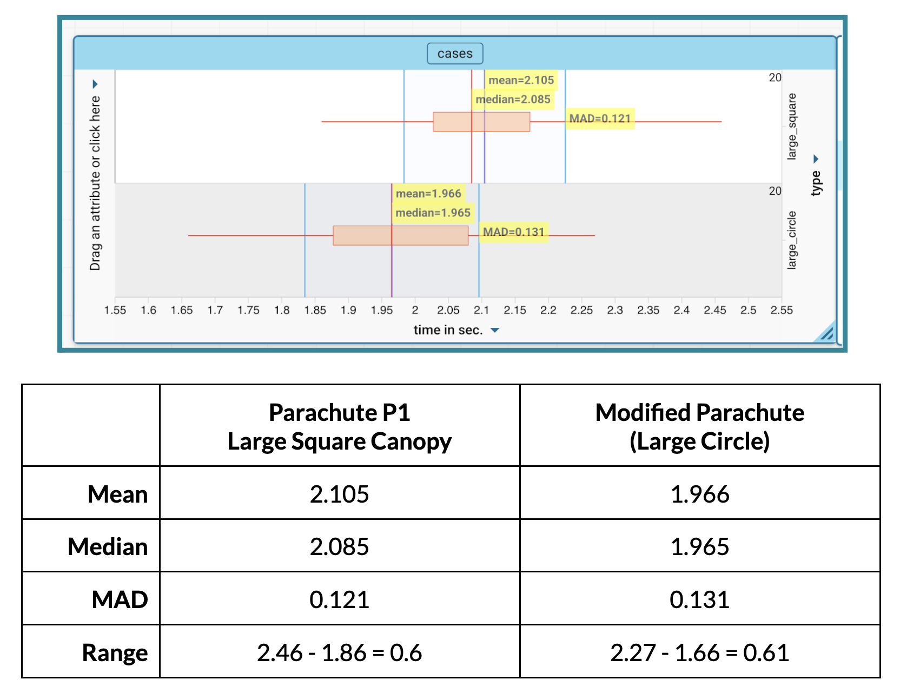

##**<u>Lesson 4: The Board Meeting</u>**

###**Objective:**
Students will present a technical brief using their CODAP box plots to argue whether their parachute canopy design modification created a significant change in performance or merely random variation.

###**Materials:**

1. Projector

2. Student reports from [Lesson 3](lesson3.md) ([LMR_U2_L03_A_Compare-a-chutes](../MSDS_Curriculum/2_MSDS_LMRs/MSDS_LMR_Unit_2/LMR_U2_L03_A.pdf))

###**Vocabulary:**
n/a

###**Essential Concepts:**

!!! note "Essential Concepts: "
    Statistical evidence is important to engineering decisions, balancing measures of center - mean and median - with measures of spread - MAD - to determine whether an observed difference represents a real trend or just random variation. 

###**Lesson:**

<h3>Class Setup</h3>

- If possible, set up the classroom in a boardroom style setting or reserve a location in the school that will provide a boardroom style setting where groups can present their reports and discuss similarities and differences between the different parachute modifications.

<h3>Opening</h3>

1. Review the task and criteria from Part 4 of the Compare-a-Chutes handout ([LMR_U2_L03_A](../MSDS_Curriculum/2_MSDS_LMRs/MSDS_LMR_Unit_2/LMR_U2_L03_A.pdf)) completed in [Lesson 3](lesson3.md).

2. Explain to the students that while groups are presenting their reports, the rest of the class is not just listening; they are reviewing the evidence being presented to either agree or disagree with the group’s findings.

3. Provide 5-10 minutes for groups to review their reports and organize their presentations.

    
<h3>Concept Development</h3>

    <b><i>Part 1: Presentations</b></i>

4. One at a time, have groups present their reports. ***Sample presentation results below comparing Parachute P1 (Large Square Canopy) with the Large Circle canopy.***

    100. **Graphical & Numerical Evidence**: Include a screenshot of the stacked boxplots you created in CODAP. 
    

    100. **Design Comparison**: How does the design of your modified parachute compare to the Large Square parachute (P1)? ***Sample Answer: We modified the canopy of the parachute by altering the shape to a circle that is the same area as the original parachute (P1).***

    100. **Typical Performance**: How did your modification affect the typical speed of the fall? ***Sample Answer: The Large Square canopy design has a median drop time of 2.085 seconds (mean = 2.105) and the Large Circle canopy design has a median drop time of 1.965 seconds (mean = 1.966). A typical landing with the Large Circle design happens slightly sooner. A typical landing with the modified design is about 0.12 seconds faster than the Large Square canopy design (subtracting medians). In the short distance for our test runs, 0.12 seconds is likely not going to make a difference, but could if the distance were scaled up to a high-altitude jump. ***

    100. **Reliability**: How did your modification affect the reliability of the parachute? ***Sample Answer: It didn’t really affect the reliability all that much because the MAD values were 0.121 and 0.131, which are really close. If we are strictly wanting lower MAD values, then the Large Square canopy would be more reliable.***

    100. **The Statistical Verdict**: Do you think the difference between Parachute P1 and your modified parachute is meaningful? ***Sample Answer: We do not think the difference between the parachutes is meaningful because there is a lot of overlap in the boxplots and they have similar MAD values.***

    100. **Final Recommendation**: Based on the evidence, should the company adopt your modification, reject it, or do more testing? Justify your decision using your data. ***Sample Answer: Since there is no meaningful difference, we should likely just keep our original design. It doesn’t make budgetary sense to redo the entire design based on these results.***

    <b><i>Part 2: Agree or Disagree</b></i>

5. Lead a quick discussion using the following questions:

    100. Were there any groups that you did not agree with their findings? If so, what was a common theme among them? ***Possible answer: Students may disagree with a group's findings if, for example, the shape/size of the parachute changed but the results remained the same. This might suggest that there was a discrepancy in the measurements of descent times, there was a design error in the construction of the modified parachute, or that the change had no effect.***

    100. Which design modification moved the center the most? Provide evidence to support your answer. ***Answers will vary depending on class results.***

    100. Which one was the most consistent? Provide evidence to support your answer. ***Answers will vary depending on class results.***

    
<h3>Closing</h3>

6. Key Takeaway: Statistical evidence allows us to support our findings by referring to the data and the analysis.

7. Exit Ticket: If we were to combine two designs for the ultimate parachute, which two modifications from today showed the most promise? Use the data presented by other groups to justify your answer.

