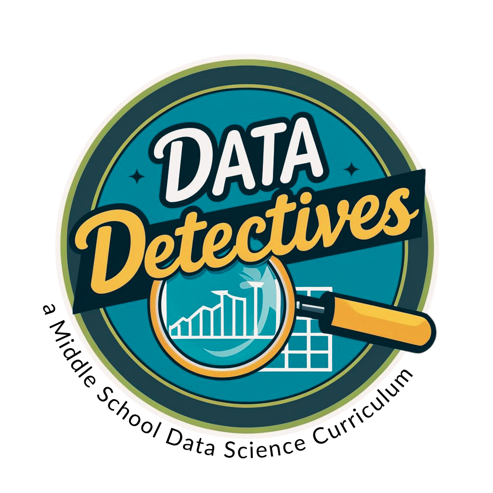

#Unit 2: Table of Contents

<table class="tg">
  <tr>
    <th class="tg-7klg" colspan="6"></th>
  </tr>
  <tr>
    <th class="tg-7klg" colspan="6">Unit 2: Table of Contents</th>
  </tr>
  <tr>
    <td class="tg-km2t" colspan="3">Content</td>
    <td class="tg-km2t"></td>
    <td class="tg-km2t"></td>
    <td class="tg-aw21">Page</td>
  </tr>
  <tr>
    <td class="tg-km2t" colspan="3"><a href="../unit1/overview">Table of Contents</a></td>
    <td class="tg-km2t"></td>
    <td class="tg-km2t"></td>
    <td class="tg-aw21"><a href="../unit1/overview">2</a></td>
  </tr>
  <tr>
    <td class="tg-zv4m"></td>
    <td class="tg-zv4m" colspan="2">Section 1: <a href="../unit2/section1">Compare-a-Chutes</a></td>
    <td class="tg-zv4m"></td>
    <td class="tg-zv4m"></td>
    <td class="tg-aw21"><a href="../unit2/section1">3</a></td>
  </tr>
  <tr>
    <td class="tg-zv4m"></td>
    <td class="tg-zv4m"></td>
    <td class="tg-zv4m">Lesson 1: <a href="../unit2/lesson1">Compair-a-Chutes</a></td>
    <td class="tg-zv4m"></td>
    <td class="tg-zv4m"></td>
    <td class="tg-8jgo"><a href="../unit2/lesson1">4</a></td>
  </tr>
  <tr>
    <td class="tg-zv4m"></td>
    <td class="tg-zv4m"></td>
    <td class="tg-zv4m">Lesson 2: <a href="../unit2/lesson2">Construct-a-Chute</a></td>
    <td class="tg-zv4m"></td>
    <td class="tg-zv4m"></td>
    <td class="tg-8jgo"><a href="../unit2/lesson2">10</a></td>
  </tr>
  <tr>
    <td class="tg-zv4m"></td>
    <td class="tg-zv4m"></td>
    <td class="tg-zv4m">Lesson 3: <a href="../unit2/lesson3">Compare-a-Chutes</a></td>
    <td class="tg-zv4m"></td>
    <td class="tg-zv4m"></td>
    <td class="tg-8jgo"><a href="../unit2/lesson3">18</a></td>
  </tr>
  <tr>
    <td class="tg-zv4m"></td>
    <td class="tg-zv4m"></td>
    <td class="tg-zv4m">Lesson 4: <a href="../unit2/lesson4">The Board Meeting</a></td>
    <td class="tg-zv4m"></td>
    <td class="tg-zv4m"></td>
    <td class="tg-8jgo"><a href="../unit2/lesson4">28</a></td>
  </tr>
  <tr>
    <td class="tg-zv4m"></td>
    <td class="tg-zv4m"></td>
    <td class="tg-zv4m">Progress Check 1: <a href="../unit2/progresscheck1">Can You Weigh the Evidence?</a></td>
    <td class="tg-zv4m"></td>
    <td class="tg-zv4m"></td>
    <td class="tg-8jgo"><a href="../unit2/progresscheck1">57</a></td>
  </tr>
  <tr>
    <td class="tg-zv4m"></td>
    <td class="tg-zv4m" colspan="2">Section 2: Warning Signs</td>
    <td class="tg-zv4m"></td>
    <td class="tg-zv4m"></td>
    <td class="tg-aw21">59</td>
  </tr>
  <tr>
    <td class="tg-zv4m"></td>
    <td class="tg-zv4m"></td>
    <td class="tg-zv4m">Lesson 5: Reaching Higher</td>
    <td class="tg-zv4m"></td>
    <td class="tg-zv4m"></td>
    <td class="tg-8jgo">32</td>
  </tr>
  <tr>
    <td class="tg-zv4m"></td>
    <td class="tg-zv4m"></td>
    <td class="tg-zv4m">Lesson 6: Two Measurements One Story</td>
    <td class="tg-zv4m"></td>
    <td class="tg-zv4m"></td>
    <td class="tg-8jgo">40</td>
  </tr>
  <tr>
    <td class="tg-zv4m"></td>
    <td class="tg-zv4m"></td>
    <td class="tg-zv4m">Lesson 7: Describing Patterns in Scatterplots</td>
    <td class="tg-zv4m"></td>
    <td class="tg-zv4m"></td>
    <td class="tg-8jgo">50</td>
  </tr>
  <tr>
    <td class="tg-zv4m"></td>
    <td class="tg-zv4m"></td>
    <td class="tg-zv4m">Lesson 8: Warning Signs</td>
    <td class="tg-zv4m"></td>
    <td class="tg-zv4m"></td>
    <td class="tg-8jgo">60</td>
  </tr>
  <tr>
    <td class="tg-zv4m"></td>
    <td class="tg-zv4m"></td>
    <td class="tg-zv4m">Lesson 9: The Point of No Return</td>
    <td class="tg-zv4m"></td>
    <td class="tg-zv4m"></td>
    <td class="tg-8jgo">66</td>
  </tr>
  <tr>
    <td class="tg-zv4m"></td>
    <td class="tg-zv4m"></td>
    <td class="tg-zv4m">Lesson 10: Off the Charts</td>
    <td class="tg-zv4m"></td>
    <td class="tg-zv4m"></td>
    <td class="tg-8jgo">74</td>
  </tr>
  <tr>
    <td class="tg-zv4m"></td>
    <td class="tg-zv4m"></td>
    <td class="tg-zv4m">Progress Check 2</td>
    <td class="tg-zv4m"></td>
    <td class="tg-zv4m"></td>
    <td class="tg-8jgo">98</td>
  </tr>
  <tr>
    <td class="tg-zv4m"></td>
    <td class="tg-zv4m" colspan="2">Section 3: Animal Associations</td>
    <td class="tg-zv4m"></td>
    <td class="tg-zv4m"></td>
    <td class="tg-aw21">102</td>
  </tr>
  <tr>
    <td class="tg-zv4m"></td>
    <td class="tg-zv4m"></td>
    <td class="tg-zv4m">Lesson 11: The Average Bear</td>
    <td class="tg-zv4m"></td>
    <td class="tg-zv4m"></td>
    <td class="tg-8jgo">80</td>
  </tr>
  <tr>
    <td class="tg-zv4m"></td>
    <td class="tg-zv4m"></td>
    <td class="tg-zv4m">Lesson 12: Just the Facts</td>
    <td class="tg-zv4m"></td>
    <td class="tg-zv4m"></td>
    <td class="tg-8jgo">89</td>
  </tr>
  <tr>
    <td class="tg-zv4m"></td>
    <td class="tg-zv4m"></td>
    <td class="tg-zv4m">Lesson 13: Fact Check</td>
    <td class="tg-zv4m"></td>
    <td class="tg-zv4m"></td>
    <td class="tg-8jgo">103</td>
  </tr>
  <tr>
    <td class="tg-zv4m"></td>
    <td class="tg-zv4m"></td>
    <td class="tg-zv4m">Lesson 14: How Are the Categories Spread Out?</td>
    <td class="tg-zv4m"></td>
    <td class="tg-zv4m"></td>
    <td class="tg-8jgo">113</td>
  </tr>
  <tr>
    <td class="tg-zv4m"></td>
    <td class="tg-zv4m"></td>
    <td class="tg-zv4m">Lesson 15: Two Variables at Once</td>
    <td class="tg-zv4m"></td>
    <td class="tg-zv4m"></td>
    <td class="tg-8jgo">124</td>
  </tr>
  <tr>
    <td class="tg-zv4m"></td>
    <td class="tg-zv4m"></td>
    <td class="tg-zv4m">Lesson 16: Percents Tell the Story</td>
    <td class="tg-zv4m"></td>
    <td class="tg-zv4m"></td>
    <td class="tg-8jgo">130</td>
  </tr>
  <tr>
    <td class="tg-zv4m"></td>
    <td class="tg-zv4m"></td>
    <td class="tg-zv4m">Lesson 17: From Hand to Tool</td>
    <td class="tg-zv4m"></td>
    <td class="tg-zv4m"></td>
    <td class="tg-8jgo">141</td>
  </tr>
  <tr>
    <td class="tg-zv4m"></td>
    <td class="tg-zv4m"></td>
    <td class="tg-zv4m">Lesson 18: Does the Data Tell a Story?</td>
    <td class="tg-zv4m"></td>
    <td class="tg-zv4m"></td>
    <td class="tg-8jgo">149</td>
  </tr>
  <tr>
    <td class="tg-zv4m"></td>
    <td class="tg-zv4m"></td>
    <td class="tg-zv4m">Progress Check 3</td>
    <td class="tg-zv4m"></td>
    <td class="tg-zv4m"></td>
    <td class="tg-8jgo">151</td>
  </tr>
  <tr>
    <td class="tg-km2t" colspan="3">Additional Performance Task (OPTIONAL): Unit 2 Investigative Report</td>
    <td class="tg-zv4m"></td>
    <td class="tg-zv4m"></td>
    <td class="tg-aw21">155</td>
  </tr>
  <tr>
    <td class="tg-km2t" colspan="3">References</td>
    <td class="tg-zv4m"></td>
    <td class="tg-zv4m"></td>
    <td class="tg-8jgo">160</td>
  </tr>
  <tr>
    <td class="tg-km2t" colspan="3">Instructional Strategies</td>
    <td class="tg-zv4m"></td>
    <td class="tg-zv4m"></td>
    <td class="tg-8jgo">161</td>
  </tr>

</table>
